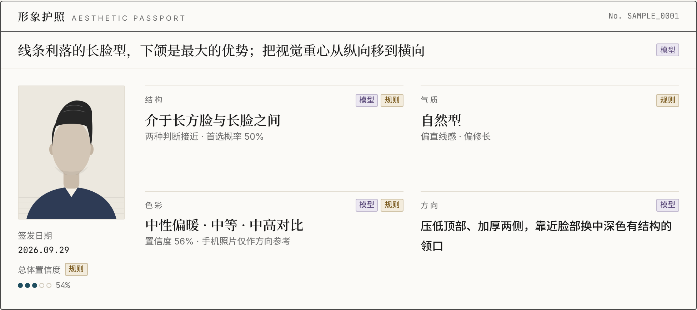
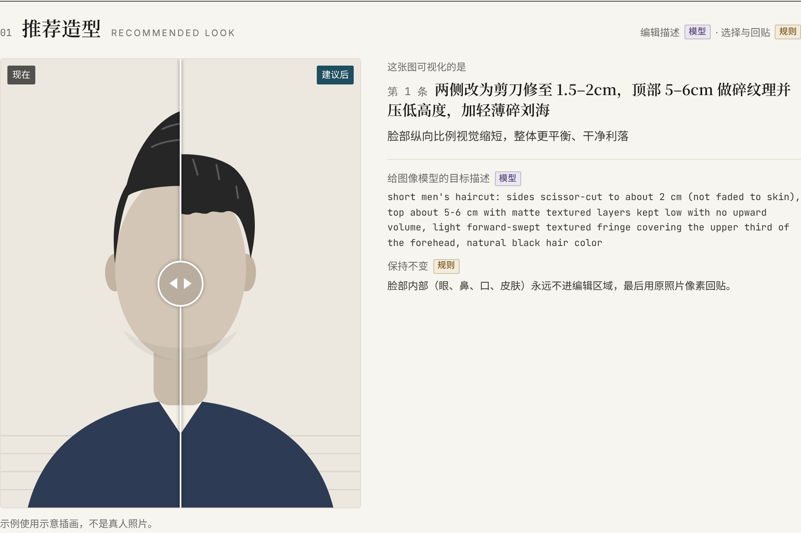
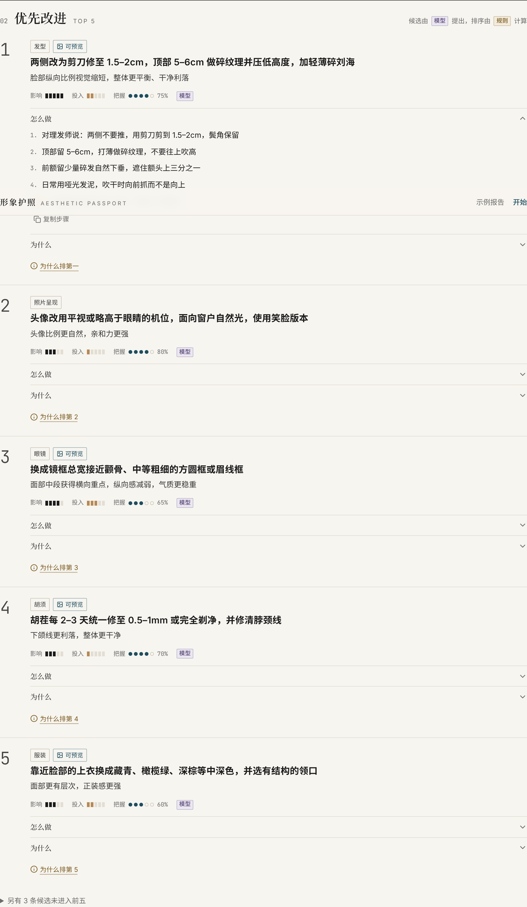
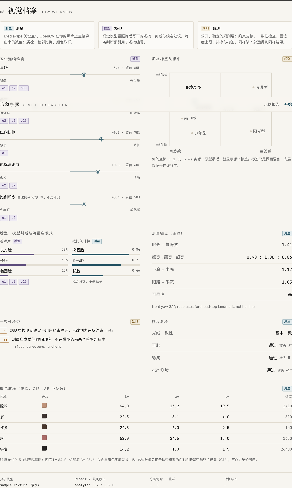
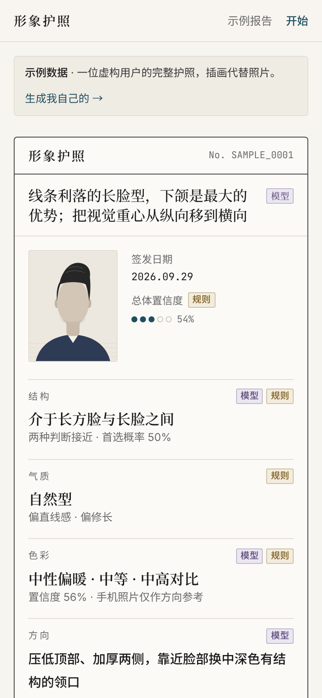
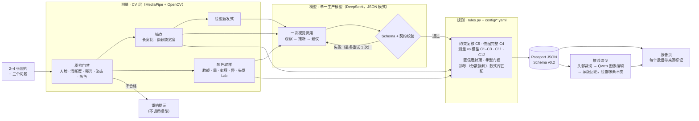

# 形象护照 · Aesthetic Passport — V2

> 上传一张正脸，30 秒内看到第一个发现：面部特点、个人色彩、八型风格方向，以及能在自己身上看见的发型、唇色、披布和穿搭建议；
> 带走一张 3:4 档案卡，随时一键删除。V2 的定稿 PRD 在 `docs/v2/`，任务与接口在 `docs/v2/V2_TASKS.md`。

**无需任何密钥即可完整体验（假模型 / 假图像编辑 / 假支付）：**

```bash
make install && make models && (cd web && npm ci)
ANALYSIS_PROVIDER=fake IMAGE_EDIT_PROVIDER=fake PAYMENT_PROVIDER=fake QC_MODE=stub make dev   # API :8000 + web :3000
# 或者完全不启动 API：
cd web && NEXT_PUBLIC_USE_FIXTURE=1 npm run dev
```

打开 `/`（落地页）、`/t/style`（话题入口）、`/start`（上传）或 `/p/ap_sample_0001`（示例档案，任何模式下都用样例数据）。
关键路径脚本：`node web/e2e/critical-path.mjs`（话题入口 → 同意 → 质检 → 揭晓 → 档案 → 反馈重排 → 免费试看 → 解锁 → 导出档案卡 → 删除）。

| 层 | V2 新增 |
|---|---|
| CV | 只需正脸（D20）；三庭五眼、虹膜比例尺；美颜检测；面部多边形（浏览器试色用，随照片 24 小时删除） |
| 模型 | 两段式：快速初见（analyzer-quick-0.1）+ 完整分析（analyzer-0.3），各自校验并修复一次（D21） |
| 规则 | 八型四层（D25）、反馈即时重排（D26）、三方向发型校验、镜框 mm、行动计划、穿搭一致性 |
| 图像 | 多目标试看、核心区像素不变 + 边缘软保护 + 颜色迁移、质量门与降级、“AI 试看”显式标识与隐式元数据（D22） |
| 商业 | 免费 vs 一次性完整护照；付费内容在服务端裁剪（D27） |

---

## V1 说明（历史）


> **EN** — Upload 2–4 photos and answer three questions → get a structured, evidence-backed personal styling report,
> ranked into a top-5 action list → see the #1 change applied to your own photo. An AI-product portfolio piece:
> multimodal pipeline → schema-constrained output → deterministic rules layer → image editing with a hard identity
> guarantee → a UI that shows where every number came from. UI in Simplified Chinese; code and comments in English.

上传 2–4 张照片、回答三个问题，得到一份**结构化、有依据、可执行**的个人形象报告：五条按优先级排好的建议，每一条都能指回照片里的具体观察；再看到第一条用在你自己照片上的样子。

不打颜值分 · 不给医美建议 · 不推断年龄、民族、性别认同或健康 · 照片 24 小时内删除。



| 推荐造型（改造前后，脸部始终是原图像素） | 优先改进 Top 5（含「为什么排第一」） |
|---|---|
|  |  |
| **视觉档案：测量 / 模型 / 规则 并排** | **手机端（375 px）** |
|  |  |

示例报告使用一位虚构用户的数据和示意插画（`/sample`），不含任何真人照片。

---

## 它证明了什么

不是「我会调视觉 API」，而是一条可追溯的产品管线：



| 来源 | 产生什么 | 代码 |
|---|---|---|
| **测量**（CV） | `input_quality`、`anchors`（含脸型启发式）、`color_measurements` | `qc.py` · `anchors.py` · `face_shape.py` · `color_sample.py` |
| **模型** | `analysis`：观察、判断、四个方向块、6–8 条候选建议——只此一处 | `analyzer.py` · `prompts/production_analyzer.md` · `schema/analysis.schema.json` |
| **规则** | `derived`：排序与分数拆解、标签、一致性标记、封顶后的置信度、季型门控、参考款式 | `rules.py` · `config/rules.yaml` · `config/hairstyles.json` |

报告界面上每个值旁边都有 `测量` / `模型` / `规则` 标记；「视觉档案」一节把模型的脸型判断和 CV 启发式并排放，矛盾时由规则层标出（C11）。

### 关键取舍（详见 [`docs/DECISIONS.md`](docs/DECISIONS.md)）

- **单一生产模型 + 完整本地校验**（D1、D10、D12）：JSON 模式只保证可解析，所以本地跑完整 Schema 和输出契约检查，失败带错误清单在同一对话里重试一次，再失败就明确报错。规则层结果（剔除、改判、封顶）从不触发重试。
- **连续维度是数据，风格标签只是界面语言**（D2）：标签是（量感，曲直）平面上离哪个原型最近。
- **硬约束不靠模型自觉**（D8）：「不染发」时，任何提到染发的建议都会被规则层改判剔除。
- **色彩只给方向**（D3、D15）：CV 取样只用来交叉检查模型；冷暖置信度封顶；季型倾向只在通过门控时显示，措辞永远是「偏向某季型」。
- **像本人由回贴保证，不靠模型**（D4、D17）：图像模型没有蒙版参数，所以最后一步是确定性的合成——眉线以下的脸、眼、鼻、口的 alpha 强制为 0。测试中即使假模型改动了每一个像素，这些区域与原图逐像素相同。

---

## 本地运行

需要：Python ≥ 3.11、Node 22；Linux 上 MediaPipe 还需要 `libegl1 libgles2`（`sudo apt-get install libegl1 libgles2`）。

```bash
make setup     # .venv + Python 依赖 + MediaPipe 模型（models/，不入库）+ web 依赖 + .env
make dev       # API http://localhost:8000 + 网页 http://localhost:3000
```

打开 http://localhost:3000 。**不需要任何密钥**也能走完整个流程：

| 没有密钥时 | 效果 |
|---|---|
| `ANALYSIS_PROVIDER=auto` → `fake` | 分析内容来自示例数据，报告顶部显示「演示模式」 |
| `IMAGE_EDIT_PROVIDER=auto` → `fake` | 效果图用简单调色演示「编辑区域 + 原脸回贴」，并注明是演示 |
| 质检、锚点、颜色取样 | 始终真实运行（MediaPipe） |

接入真实模型：在 `.env` 里填 `DEEPSEEK_API_KEY`（分析）和 `DASHSCOPE_API_KEY`（阿里云百炼中国站·北京地域，效果图），重启即可。

其他命令：

```bash
make test                                   # pytest（无需密钥；人脸相关测试需要 data/test_faces/ 下有正脸照）
make lint                                   # ruff
make passport PHOTOS=data/p01               # 命令行：照片目录（front.jpg、profile45.jpg，可选 smile、hair）→ runs/<id>/passport.json
make sample                                 # 重建示例护照（examples/ 与 web/lib/fixtures/）
make types                                  # 从 schema 生成 web/lib/passport.ts
python scripts/summarize_runs.py runs/ap_*  # 首次通过率、p50/p90、成本、安全词检查、稳定性
python scripts/ab_thinking.py --sets data/p01 data/p02 data/p03   # DeepSeek 思考模式开 / 关对比（D16）
python scripts/debug_landmarks.py <照片>    # 关键点叠图，核对编号
```

### 配置

| 变量 | 默认 | 作用 |
|---|---|---|
| `DEEPSEEK_API_KEY` / `DASHSCOPE_API_KEY` | — | 分析模型 / 图像编辑模型 |
| `DASHSCOPE_BASE_URL` | 空 | 可选；覆盖 `config/models.yaml` 里的百炼地址，如北京业务空间专属地址 `https://<WorkspaceId>.cn-beijing.maas.aliyuncs.com/api/v1`；为空则用配置里的地址 |
| `ANALYSIS_PROVIDER` / `IMAGE_EDIT_PROVIDER` | `auto` | `auto`：有密钥用真模型，否则用示例；也可设 `fake`、`none`（关闭效果图） |
| `QC_MODE` | `real` | `stub` 只用于没有模型文件的开发 / CI |
| `INVITE_CODES` | 空 | 逗号分隔；为空时不需要邀请码 |
| `DAILY_PASSPORT_LIMIT` · `IP_PASSPORTS_PER_HOUR` | 30 · 5 | 控制 API 花费 |
| `MEDIA_TTL_HOURS` · `PREVIEW_CAP` · `MAX_UPLOAD_MB` | 24 · 3 · 15 | 照片保留时长、每份护照效果图上限、单张上限 |
| `WEB_ORIGINS` | `http://localhost:3000` | CORS |
| `NEXT_PUBLIC_API_BASE`（web） | `http://localhost:8000` | 前端调用的 API 地址 |

阈值与规则全部在 `config/*.yaml`，不在代码里。

## 隐私

- 侧脸、微笑、发型照在分析结束时立即删除。
- 正脸照只用于生成效果图：它、缩略图和效果图在 24 小时后由清理任务删除（启动时与每小时运行）。质检不通过或生成失败时，所有照片立即删除。
- 保存下来的只有护照 JSON（不含照片）。日志与 `runs/<id>/calls.jsonl` 只记录指标，不记录照片或模型原文。
- 客户端 IP 只以加盐哈希形式用于限流。
- 照片、`runs/`、`data/`、模型文件永不入库（`.gitignore`）。

## 部署

- **API**：`Dockerfile`（构建时下载 MediaPipe 模型）+ `render.yaml`（Render，挂载持久磁盘到 `/data` 存 SQLite 与 24 小时媒体）。在 Render 上设置两把密钥、`WEB_ORIGINS`（网页域名）和 `INVITE_CODES`。
- **上线保护**：生产环境设 `APP_ENV=production`。此时假分析 / 假图像编辑 / 假支付 / 质检 stub 全部拒绝启动，缺密钥会直接报错而不是悄悄改用样例；
  假支付关闭后解锁页只显示"支付暂未开放"和邀请码。若要公开演示，额外设 `ALLOW_MOCK_PROVIDERS=1`，每份档案顶部会显示"演示模式"横幅。
  照片过期（24 小时）后，所有读照片、几何与试看的接口一律按已删除处理，不依赖清理任务是否已运行。
- **网页**：Vercel，Root Directory 设为 `web/`，环境变量 `NEXT_PUBLIC_API_BASE` 指向 API。
- CI：`.github/workflows/ci.yml`（ruff、pytest、示例与类型是否最新、TypeScript、next build）。

## 项目结构

```
schema/     analysis.schema.json（模型输出契约）· passport.schema.json（产品对象，v0.2）
prompts/    production_analyzer.md（analyzer-0.2）· image_edit.md（preview-0.2）· evaluator_rubric.md（离线，未启用）
config/     rules.yaml · qc.yaml · models.yaml · hairstyles.json（改编自 MIT 项目）
src/aesthetic_passport/
            qc · anchors · face_shape · color_sample · cv     ← 测量
            analyzer · providers/（deepseek · fake · image/qwen · image/fake）  ← 模型
            rules · assemble · schema_io                      ← 规则与校验
            pipeline · masks · preview · api/（FastAPI、SQLite、保留、限流）
web/        Next.js（App Router）· Tailwind · Radix；一个 <Report> 组件同时服务 /passport/[id] 与 /sample
tests/      130 个测试（无需密钥、无需网络）
docs/       MVP_BRIEF · DECISIONS · SCHEMA · ITERATION_LOG · screenshots/
```

## 状态

已完成 MVP 简报的 S0–S6（见 [`docs/MVP_BRIEF.md`](docs/MVP_BRIEF.md) 与 [`docs/ITERATION_LOG.md`](docs/ITERATION_LOG.md)）。

| 已验证 | 待真实数据 / 密钥 |
|---|---|
| 全流程（上传 → 实时质检 → 进度 → 报告 → 效果图）在 375 px 与桌面端可用 | 真实分析的首次通过率、p50 延迟、单份成本（需 `DEEPSEEK_API_KEY` 与 `data/` 照片集） |
| 质检对 7 类合成坏图按正确原因拒绝；关键点、颜色取样、蒙版均经叠图核对 | 思考模式开 / 关对比（`scripts/ab_thinking.py`） |
| 受保护脸部区域逐像素不变；图像接口失败时报告照常显示并降级为文字 | 真实效果图的「像本人」人工检查（需 `DASHSCOPE_API_KEY`） |

MVP 之后（按顺序）：评测脚本与 `/eval` 页面（`docs/EVAL.md`）· 离线评审模型 · 自动像本人检查 · 分享卡 · 第二个图像模型对比 · 英文界面。

## 致谢与许可

改编与参考的第三方代码、数据和模型见 [`THIRD_PARTY.md`](THIRD_PARTY.md)。

## ¥139 完整护照与一次性邀请码（实验）

现有网站支持免费/完整护照分层。实验价格为 ¥139/报告。可通过服务器端批量生成 100 个、24 小时有效的一次性解锁码；使用一次即失效，永久 `INVITE_UNLOCK_CODES` 不变。真实支付可选择 `PAYMENT_PROVIDER=stripe` 适配器（需商户密钥和签名回调），验证付款成功后直接解锁同一报告，不另发邀请码。未配置商户时生产环境不可真实支付。

部署和 CSV 生成说明：[docs/ops/checkout-invites.md](docs/ops/checkout-invites.md)。
