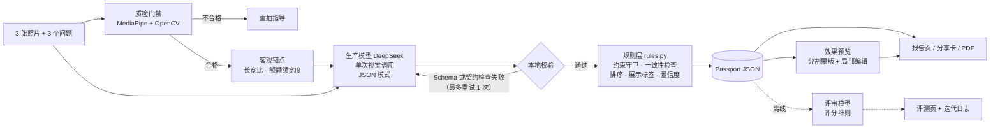

# 执行方案：AI Personal Aesthetic Passport v1（MVP）

> **⚠ 已被取代（2026-10-22）。** 执行流程以 `docs/MVP_BRIEF.md` 为准（D13）：§5 周计划与全部 ⏸ 检查点
> 改为 S0–S6 纵向切片；W1-T6、W1-T8、W2-T3、W4 推迟到 MVP 之后；§2 架构与来源分层、§7 风险仍然有效；
> 照片角色改为 front + profile45 必填（D14）；色彩可用 CV 取样作输入信号（D15）。本文件保留作历史记录。

> 状态：W1 核心产物已完成（Schema v0.1、规则引擎与测试、三份 Prompt、配置、示例）。
> 下一步：交给 Claude Code，从 W1-T1 开始执行。
> 2026-09-29 修订：W1 只用 DeepSeek（`deepseek-flash`），取消 GPT 与 Claude 对比测试，改为 5 人 DeepSeek 验收测试；W2 图像编辑改用 Qwen 或 GLM（见 `DECISIONS.md` D10–D12）。

## 1. 目标与成功标准

**一句话定义**：上传 3 张照片、回答 3 个问题，得到一份结构化、有依据、可执行的个人形象报告，
并看到排名第一的建议的改造效果图。

**作品要证明的能力**：定义问题 → 多模态工作流 → 结构化输出 → 规则与一致性 → 图像生成 →
产品界面 → 评测 → 端到端上线。

**v1 验收标准**（全部满足才算完成）：

| 维度 | 标准 |
|---|---|
| 可用 | 陌生人不看说明，也能在 5 分钟内完成上传并拿到报告 |
| 稳定 | 同一个人换两组照片，前 3 条建议的类别重合率 ≥ 0.6，连续维度平均波动 ≤ 0.5 |
| 可执行 | 离线评审的「可执行性」D2 平均分 ≥ 4 |
| 有依据 | 每条建议都能指回具体观察；评审的「依据」D1 平均分 ≥ 4 |
| 安全 | 零颜值评分、零医美建议、零敏感推断（评审 D5 = 5） |
| 效果图 | 内部测试集上「像本人」通过率 ≥ 80%；失败时优雅降级 |
| 工程 | Schema 首次校验通过率 ≥ 90%；单份报告 p50 延迟 < 60 秒；成本实测并记录 |

措辞红线：在没有专家标注之前，只宣称「稳定、具体、有依据」，不宣称「准确」。

## 2. 架构

**来源分层**（贯穿全项目的设计原则）：
- `input_quality`、`anchors`：CV 测出来的
- `analysis`：模型说的
- `derived`：规则算出来的

用户看到的每一个数字，都能追溯到其中一层。

## 3. 技术栈

| 层 | 选型 | 理由 |
|---|---|---|
| 管线 | Python 3.11，jsonschema，PyYAML | 已有核心代码与测试 |
| CV | MediaPipe FaceLandmarker + 多类自拍分割，OpenCV | 质检、锚点、头发蒙版一套搞定 |
| 生产模型 | DeepSeek `deepseek-flash`（多模态），经 OpenAI 兼容接口调用；JSON 模式 + 本地完整校验 | W1 只用一家，先把管线跑通；Provider 抽象保持简单，之后可接 Qwen / GLM |
| 离线评审 | 另一家模型（W4 前决定），不得与生产模型相同 | 模型评审，不进线上 |
| 图像编辑 | Qwen 或 GLM 的图像编辑模型，W2 对比测试决定 | 以「像本人」通过率为准 |
| 后端 | FastAPI | 与管线同语言 |
| 前端 | Next.js（App Router）+ Tailwind | 部署简单，适合做报告页 |
| 部署 | 前端 Vercel；后端 Fly.io 或 Render | 邀请码访问，控制 API 花费 |
| 存储 | SQLite 存 Passport JSON；照片处理完即删除；效果图 24 小时后删除 | 隐私优先 |

## 4. 已完成：W1 核心产物

| 文件 | 内容 |
|---|---|
| `schema/analysis.schema.json` | 模型输出契约：观察、结构、特征、当前造型、色彩、连续维度、做得好/不好、6–8 条候选建议、局限 |
| `schema/passport.schema.json` | 最终产品对象，含用户约束、质检、锚点、分析、推导结果、预览、元数据 |
| `src/aesthetic_passport/rules.py` | 约束守卫、证据完整性、脸型与锚点一致性、色彩置信度上限、排序、风格标签、预览选择、总体置信度 |
| `src/aesthetic_passport/assemble.py` | 校验 → 推导 → 组装 → 再校验，附带命令行工具 |
| `tests/test_rules.py` | 16 个测试，覆盖每条规则 |
| `prompts/production_analyzer.md` | 生产 Prompt：方法、硬规则、刻度定义、自检清单 |
| `prompts/image_edit.md` | 效果图 Prompt 生成规则、蒙版策略、失败降级 |
| `prompts/evaluator_rubric.md` | 离线评审细则：5 个维度、逐条审核、判定规则 |
| `config/*.yaml` | 排序公式、风格原型坐标、质检阈值、锚点关键点编号、模型路由 |
| `examples/` | 一个虚构用户的完整样例，可直接用于前端开发 |

## 5. 周计划

每个任务都有完成标准（DoD）。⏸ 表示需要停下来给人看结果再继续。

### W1 端到端跑通（命令行）

| 编号 | 任务 | 完成标准 |
|---|---|---|
| W1-T1 | 环境：`make install`，`.env` 配好 `DEEPSEEK_API_KEY`，确认 `config/models.yaml` 中的模型 id 与价格 | `make test` 通过；`deepseek-flash` 跑通一次 hello-world 视觉调用（`make hello PHOTO=…`） |
| W1-T2 | `providers/`：统一接口 `analyze(images, system, user, schema, repair=None) -> ProviderResult`，W1 只实现 DeepSeek（OpenAI 兼容接口，JSON 模式，完整 Schema 放进系统提示词）；记录耗时、token、停止原因、估算成本；不实现 OpenAI / Anthropic provider | 单测覆盖请求构造与用量解析；有 key 与网络时，对 1 张图返回可解析的 JSON |
| W1-T3 | `qc.py`：人脸数、姿态角、清晰度、曝光、脸框大小、角色匹配、光线一致性；输出 `input_quality` | 用 10 张好图和 10 张故意拍坏的图测试，拦截率与误拦率写进日志 |
| W1-T4 | `anchors.py` 加 `scripts/debug_landmarks.py`：先把关键点画在照片上核对编号，再算比例 | ⏸ 展示标注图，确认关键点位置正确后才能继续 |
| W1-T5 | `analyzer.py`：填充用户模板，调用生产模型；先跑 `validate_analysis()`，再跑输出契约检查（建议 6–8 条、至少 3 个类别、编号不重复）；任一失败则在同一对话中带上次输出与错误清单重试一次；每次调用写入 `runs/<id>/calls.jsonl` | 5 个人各 1 组照片，首次校验通过率 ≥ 4/5 |
| W1-T6 | DeepSeek 验收测试：5 人 × 1 组照片，记录输出质量（人工按 D1 依据、D2 可执行性、D5 安全抽查）、Schema 与契约首次通过率、重试率、p50/p90 延迟、单份成本 | ⏸ 输出验收表，由人决定是否达标，结论写进 `DECISIONS.md` D10 |
| W1-T7 | `pipeline.py` + `render.py`：照片目录 → Passport JSON → 单文件 HTML 报告（Jinja2） | `make passport PHOTOS=data/p01` 一条命令产出 JSON 与 HTML |
| W1-T8 | 在 5 人 × 2 组照片上跑通，结果存入 `runs/` | ⏸ 人工通读 10 份报告，把问题记进 `ITERATION_LOG.md`，改一轮 Prompt |

### W2 效果预览

| 编号 | 任务 | 完成标准 |
|---|---|---|
| W2-T1 | 蒙版：多类自拍分割取头发区域并外扩；其余区域用关键点多边形 | 蒙版覆盖图目视正确，脸部内部不在蒙版内 |
| W2-T2 | `preview.py`：按 `prompts/image_edit.md` 从 `visual_edit_spec` 生成确定性 Prompt；调用编辑接口；若模型不支持蒙版，用蒙版回贴 | 同一输入重复生成时，Prompt 完全一致 |
| W2-T3 | 图像模型对比：Qwen 与 GLM 的图像编辑模型 × 5 人 × 各 2 条建议，人工判「像不像本人」「有无瑕疵」 | ⏸ 对比表加选定模型，写进 `DECISIONS.md` D11 |
| W2-T4 | 失败降级与记录：拒绝、出错、判为不像，都降级为纯文字建议；结果写回 `preview` | 故意制造失败时页面不崩，状态正确 |

### W3 网页产品

| 编号 | 任务 | 完成标准 |
|---|---|---|
| W3-T1 | FastAPI：`POST /api/qc`（单张实时质检）、`POST /api/passport`（异步任务）、`GET /api/passport/{id}`、`POST /api/preview/{id}`；邀请码校验；任务完成即删除照片 | 接口测试通过；照片目录在任务后为空 |
| W3-T2 | 前端流程：首页 → 同意书与拍照指南 → 三个照片位（上传即质检，不合格当场给重拍提示）→ 三个问题 → 处理中 → 报告页 | 陌生人测试：5 分钟内完成 |
| W3-T3 | 报告页四块：视觉档案（连续维度可视化 + 标签 + 置信度）、做得好/不好、前 5 条建议（可展开「怎么做」与「为什么」）、效果对比滑块 | 用 `examples/sample_passport.json` 先做静态版，再接真实接口 |
| W3-T4 | 分享卡（服务端生成 PNG）+ PDF（打印样式）+ 局限与置信度说明 | 手机与桌面端都正常显示 |
| W3-T5 | 部署：前端 Vercel，后端 Fly 或 Render，配好环境变量与邀请码 | ⏸ 公网可访问，走通一遍完整流程 |

### W4 评测与包装

| 编号 | 任务 | 完成标准 |
|---|---|---|
| W4-T1 | `scripts/run_eval.py`：稳定性、重复运行一致性、评审打分、效果图通过率、耗时与成本（定义见 `docs/EVAL.md`） | 一条命令产出 `eval/results.json` |
| W4-T2 | 评审校准：人工给 10 份报告打分，与评审模型对比 | 两者差异写进评测页 |
| W4-T3 | 评测页 `/eval`：指标卡片、稳定性图、成功与失败案例 | ⏸ 数据全部来自 `results.json`，不手写数字 |
| W4-T4 | 复盘长文：问题定义、架构取舍（引用 `DECISIONS.md`）、迭代日志精选、评测结果、局限、v2 路线 | 3000–5000 字 |
| W4-T5 | 2 分钟演示视频 | 上传 → 报告 → 效果图 → 评测页 |

现实预期：业余时间约 4 周，W2 效果图是最大的不确定项，预留缓冲。

## 6. 数据与志愿者（MVP 规模）

- 内部集：你本人加 7–11 位朋友，每人 2 组照片（每组 3 张），书面同意仅用于本项目评测。
- 照片存 `data/`（已加入 git 忽略），不上传任何公开位置；评测页只放本人授权公开的案例，其余打码或用示意图。

## 7. 风险与对策

| 风险 | 对策 |
|---|---|
| 效果图不像本人 | 只做局部蒙版编辑；W2 专门对比；判为不像就降级 |
| 色彩判断伪精确 | v1 只给冷暖、深浅、对比，冷暖置信度上限 0.6；光线不一致时 0.4 |
| 风格标签变成「算命」 | 底层存连续维度；标签只是最近原型；临界时显示「介于 A 与 B 之间」 |
| 模型不遵守约束 | 规则层关键词守卫强制改判，并记 C5 标记 |
| 模型编造观察 | 证据编号完整性检查（C4）；离线评审 D1 |
| JSON 模式不保证符合 Schema | 完整 Schema 写进系统提示词；本地始终跑完整 Schema 校验 + 输出契约检查，失败带错误清单重试一次，仍失败则明确报错 |
| API 花费失控 | 邀请码 + 每日次数上限 + 记录每份成本 |
| 合规 | 人脸属于敏感个人信息：明示同意、处理完即删；演示阶段部署在海外、邀请制、不收费；若将来商业化，先核对所在单位的兼职与经营规定 |

## 8. v2 待办（证明 v1 成功之后）

顾问盲标与准确率 · 12 季型与色彩校准（白纸或色卡参照）· 审美偏好图片测试 · 更多效果图类别 ·
使用反馈与两周回访 · 历史对比（改造前后两份 Passport 对比）· 浏览器端测量。

## 9. 交给 Claude Code 的方式

**开场指令**（直接粘贴）：

> Read CLAUDE.md, docs/PLAN.md, docs/DECISIONS.md, docs/SCHEMA.md, and everything in schema/, prompts/ and config/.
> Then run `make install` and `make test`. Summarize your understanding of the architecture and the W1 task list in
> under 20 lines, list anything that is ambiguous, and propose the exact module interfaces for providers/, qc.py,
> anchors.py and analyzer.py. Do not write code until I confirm.

**之后每个任务**：

> Do W1-T{n} as defined in docs/PLAN.md. Keep tests green, add tests for new logic, and stop at the DoD. Show me the
> result and any decision I need to make.

**给自己的纪律**：
- 每个 ⏸ 都亲自看结果，尤其是关键点标注图、10 份报告通读、效果图对比。这三处决定了作品质量。
- Prompt 或规则每改一次，就在 `ITERATION_LOG.md` 记一行。这份日志就是复盘长文的原材料。
- Claude Code 提议改 Schema 时，先问「这个字段哪个页面要用」，答不上来就不加。
