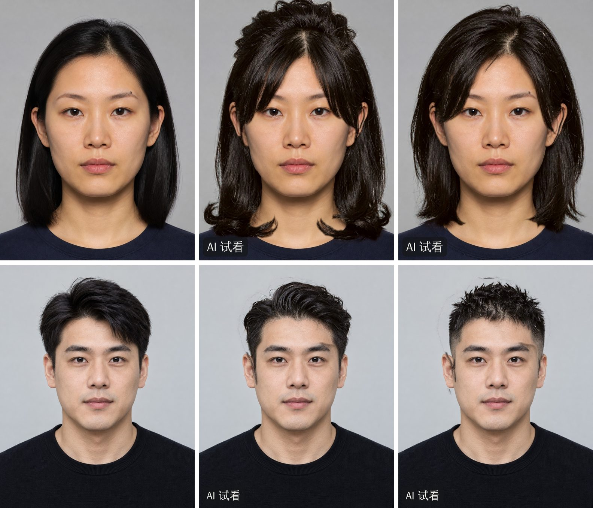

# Issue #1 — live Qwen hairstyle previews on the approved synthetic portraits



Left to right: the original, then two clearly different directions from the passport's own `hair_options`. Top: AI
虚构人物 001 (`safe` curtain fringe with curled collarbone ends; `easy` lob, no fringe). Bottom: AI 虚构人物 002 (`safe`
tapered cut with a swept top; `bold` cropped top with faded sides). Every preview is a real `qwen-image-2.0` result,
registered onto the original face and composited by `render_target`; nothing is a fixture or an illustration. The
portraits are the owner-approved, fully AI-synthesized adults already published for the sample reports (D41).

## What was checked, in order

1. **Access.** A non-generating probe of the workspace endpoint returned `HTTP 400 InvalidParameter` for an empty
   request (authenticated, nothing billed). In Claude Code Cloud the credential is injected by the egress proxy and the
   VM's `DASHSCOPE_API_KEY` holds a non-secret placeholder, so the existing `QwenImageEditProvider` and
   `resolve_image_provider` worked **unchanged**: no auth code was modified. Production still requires the real
   server-side `DASHSCOPE_API_KEY`; nothing here relaxes that.
2. **One genuine request** through `QwenImageEditProvider.edit()`: HTTP 200, one decodable 1088×1456 image, 8.9 s,
   about USD 0.03 (configured price; CNY 0.20 officially).
3. **Real pipeline runs** on two identities, two directions each, through the production job path
   (`request_previews` → `run_preview_job`), driven by `scripts/live_hair_preview.py`.

## What the real output exposed, and what changed

The first real generations were rejected or carried visible artifacts. Each fix is limited to what was observed and
has a regression test with a control that shows the defect when the rule is switched off (`tests/test_preview_registration.py`).

| Observed in real output | Cause | Fix |
|---|---|---|
| 3 of 4 first generations rejected as "head moved too far" (the reported fallback images) | Qwen returns the same face 9–15.5 % smaller and ~0.12 cheek widths off; the inner face is a rigid copy (residual 0.005–0.008). The ±0.12 scale limit was "provisional", and side hair over the cheek edge made two cheek-contour landmarks look "reshaped" | `max_scale_dev` 0.12 → 0.20; cheek-contour landmarks leave the registration |
| Revealed wall tinted pink (+7 R / −7 B) | Skin-derived Lab offset applied to background pixels | Not applied where the generated image shows wall |
| Doubled (ghost) ear | Generated ear a few pixels off the real one, blended over it | Original ears/neck kept; generated skin never pasted over original wall |
| Floating strands on the wall after the cut changed | Original flyaways the segmenter misses | Thin original-only lines near the hair are replaced (never near the face, never imported) |
| Old fringe's outline visible on the forehead (≈ 50-level step) | Original skin beside the old hair is still shadowed; the generated skin is clean | Shadowed original face skin contiguous with the mask joins it |
| Skin-coloured hole in a fringe over the brow | Brow-landmark hull frozen where the segmenter called thin strands "not hair" | Protect the brow's own dark pixels; strands connected to hair are hair |
| Chin-length target ended at the collar; messy shag with flyaways | Prompt wording ("…around the neck and shoulders", "irregular strands… restrained flyaways") | Prompt v0.6: length as a hard limit, groomed finish |

Two attempts did not work and were reverted: matching the revealed skin's tone to the shadowed original made a darker
band instead of removing it, and a strand rule that compared "differs" in either direction imported strands the model
had invented.

## Acceptance run (final code, prompt `preview-0.6`)

| Portrait | Direction | Status | Attempts | Provider latency | Total | Est. cost |
|---|---|---|---|---|---|---|
| 001 | `safe` | succeeded | 1 | 9.1 s | 12.7 s | USD 0.03 |
| 001 | `easy` | succeeded | 1 | 8.6 s | 11.4 s | USD 0.03 |
| 002 | `safe` | succeeded | 1 | 8.0 s | 11.1 s | USD 0.03 |
| 002 | `bold` | succeeded | 1 | 7.9 s | 10.5 s | USD 0.03 |

Before the registration fix, 1 of the first 4 generations was accepted; afterwards, 30 of 30 were accepted on the first
attempt. Compositing takes about 2 s of the total. 34 generations were made in all (≈ USD 1.0 at the configured price).
No call failed at the provider; failure states, retry and entitlement behavior come from PR #7 and #24 and are unchanged.

Objective checks on all four final previews: exactly one face; eye/brow/nose/mouth drift 0.001–0.021 cheek widths
(gate 0.03); eye, nose and mouth pixels differ from the original by 0.53 levels (JPEG noise only); wall beside the
hair within 3.1 levels of the far wall.

## Assessment — not a clean sweep

- **Identity, features, ears:** held on all four. Eyes, nose, mouth and skin are the user's own pixels by
  construction; the ears are single and natural.
- **Style match and differentiation:** each pair is clearly different from the original and from each other. `easy`
  is a groomed lob that ends at the collar, **not** the chin-length bob its target describes; a `safe` target's 7:3
  part came out centred in every sample.
- **Hair texture:** natural strands and highlights on 001 `easy`, 002 `safe` and 002 `bold`. 001 `safe` has a
  clumped, curly crown (seed-dependent: other seeds were smoother) that touches the top of the frame.
- **Remaining artifacts:** on 002 a faint tan strip above the right brow (the old fringe's shadow inside the
  protected brow zone, which the compositor deliberately does not edit); faint arc fragments near the top and
  left of 002 `bold`, where the crop-boundary fade lets some old strands show; fringe strands crossing the eye end
  flat at the protected core on 001.
- **Scope:** two synthetic identities, one seed each for the final run. Live acceptance for real, consented photos
  is still open.

## Reproduce

```sh
# Needs a Beijing DashScope key (and DASHSCOPE_BASE_URL for a workspace endpoint); about USD 0.03 per image.
IMAGE_EDIT_PROVIDER=qwen PYTHONPATH=src python scripts/live_hair_preview.py --person person-001 --targets safe easy
IMAGE_EDIT_PROVIDER=qwen PYTHONPATH=src python scripts/live_hair_preview.py --person person-002 --targets safe bold
```

The script refuses a fake or disabled provider, writes under `runs/live-hair-preview` (git-ignored) and records only
status, attempts, model, latency, cost and sanitized diagnostics: no prompts, pixels, keys, headers or URLs.
