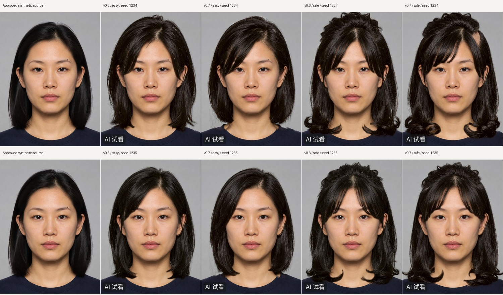

# Issue #1 follow-up: safe live runs and target adherence

Continues merged PR #29 from `main` at `1adbb6c`. Reuses the existing Qwen provider, preview job, registration,
protected composite, quality gates and retry/entitlement behavior. No model, auth, QC or homepage changes.



Every portrait here is the already-public, owner-approved **synthetic adult Person-001** (D41). These are genuine
Qwen generations through `request_previews` → `run_preview_job`, not fake-provider outputs. Rows: seeds 1234 and
1235. Columns: original; v0.6 `easy`; v0.7 `easy`; v0.6 `safe`; v0.7 `safe`. Both seeds are shown, including misses.

## Verified changes

- The acceptance script deleted the entire CLI-supplied `--out` via `shutil.rmtree`. It now deletes nothing:
  defaults create unique runs beneath `runs/live-hair-preview`; explicit outputs must be new children there.
  Repository root/ancestors, unrelated paths, existing runs and paths escaping through symlinks are rejected
  before reading inputs or making calls. Tests check preservation of sentinel files and CLI rejection.
- v0.6 reproduced the reported chin-length-to-collar miss and insufficiently offset part. v0.7 appends only the
  matching target instructions for `chin-length`, `7:3` and `no fringe`. Descriptions stay verbatim; unrelated
  examples do not enter the request, and current-cut recolours/non-hair edits receive no extra constraints.
  A broad conditional template was discarded: it kept a long perimeter and introduced an unwanted front sweep.
  Focused tests exercise the prompt-file loader and target selection, including current-cut and non-hair controls.

## What the side-by-side establishes

- **Identity/features:** all four final outputs passed the unchanged registration/composite gates on the first
  attempt. Visual inspection of raw outputs and served composites found a recognizable same person, single
  eyes/brows/ears, and no conspicuous shifted or duplicated facial features.
- **Length:** seed 1234 `easy` becomes visibly shorter and rounder, closer to a jaw-length bob, with the forehead
  exposed. Seed 1235 still reaches the lower neck. **Reliable exact chin-length adherence has not passed.**
- **Part:** seed 1234 `safe` has a visibly displaced scalp part and asymmetric sweep. Seed 1235 remains too close
  to the centre. **Reliable 7:3 adherence has not passed.**
- **Naturalness:** `easy` is tidier; the `safe` crown remains overly raised/clumped, and some edge strands remain
  imperfect. This is a bounded improvement, not a clean visual-acceptance pass. Passing the existing geometric
  gate is not a style-match verdict. No thresholds, registration or identity protection were relaxed.

## Measured operational facts

One non-generating auth probe returned HTTP 400 `InvalidParameter`; no credential changes were needed. Each row
below generated one image, with no retry. Timings include the actual provider download and production preview job.

| Prompt | Seed | Target | Provider | Total | Estimated cost |
|---|---:|---|---:|---:|---:|
| v0.6 | 1234 | safe | 15.32 s | 18.85 s | USD 0.03 |
| v0.6 | 1234 | easy | 11.16 s | 14.19 s | USD 0.03 |
| v0.6 | 1235 | safe | 11.99 s | 15.64 s | USD 0.03 |
| v0.6 | 1235 | easy | 9.09 s | 12.14 s | USD 0.03 |
| v0.7 | 1234 | safe | 13.45 s | 17.21 s | USD 0.03 |
| v0.7 | 1234 | easy | 9.75 s | 12.83 s | USD 0.03 |
| v0.7 | 1235 | safe | 12.24 s | 17.00 s | USD 0.03 |
| v0.7 | 1235 | easy | 10.79 s | 13.78 s | USD 0.03 |

Eight comparison images cost an estimated USD 0.24; four discarded exploratory images add USD 0.12 (12 total,
USD 0.36 estimated). The bounded study allowed at most 24 attempts / USD 0.72 including existing retries; none
were needed. **Actual billed cost is unavailable**: USD 0.03 is the configured estimate, not a billing observation.
No credentials, workspace identifiers, prompts, private photographs or provider result URLs are published.

## Reproduce the final pair

```sh
# Normal server-side key environment; workspace endpoint via DASHSCOPE_BASE_URL when required.
IMAGE_EDIT_PROVIDER=qwen PYTHONPATH=src python scripts/live_hair_preview.py --person person-001 --targets safe easy
# Optional explicit NEW output: --out runs/live-hair-preview/my-comparison
```

For seed 1235, in a fresh Python process set
`load_models_config()["production"]["image_edit"]["seed"] = 1235` from
`aesthetic_passport.providers.base`, then run the same script with `runpy.run_path(..., run_name="__main__")`.
The in-memory override is confined to this acceptance process; production keeps configured seed 1234.
Each run prints its unique directory. Its `summary.json` and `calls.jsonl` retain sanitized operational facts.

Focused verification: `pytest -q tests/test_live_hair_preview.py tests/test_preview.py tests/test_preview_registration.py
 tests/test_hair_masks.py` — 113 passed, 2 skipped (no genuine test photos).

## Acceptance still blocked

Issue #1 remains open. No privately supplied, explicitly consented **genuine person's frontal photo** is mounted
in `data/test_faces`; the public synthetic portrait does not satisfy that requirement. That input is needed for
two distinct usable outcomes, with private identity/naturalness review. Exact chin length, consistent 7:3 part,
actual billed cost and a separate production deployment smoke test also remain unverified. Do not infer Render
readiness from this Codex proxy-authenticated run.

Repository checks: `make test` — **591 passed, 32 skipped**; `make lint` and `git diff --check` passed. The first full
run had two keyless-provider selection failures because the managed environment inherits `DEEPSEEK_AUTH_VIA_PROXY=1`;
the clean run used `DEEPSEEK_AUTH_VIA_PROXY=0` with all fake-provider switches for these no-key tests. No unrelated
provider code was changed. MediaPipe used the normal downloaded models and a locally extracted Debian `libgles2`.
