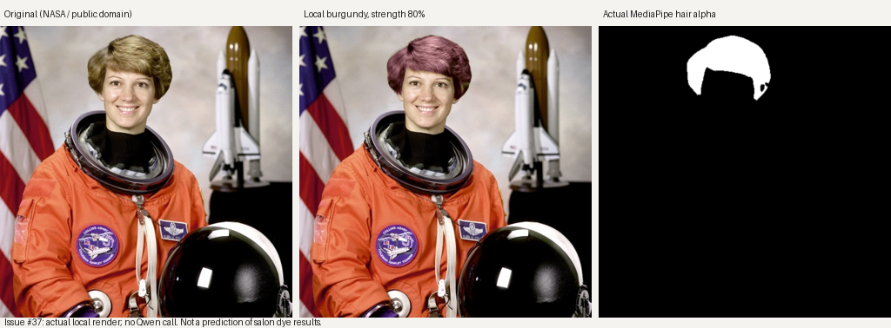

# Local hair recoloring: one real-photo check



Source: NASA's public-domain Eileen Collins portrait, via [scikit-image's astronaut sample](https://github.com/scikit-image/scikit-image/blob/v0.24.0/skimage/data/astronaut.png). Scikit-image documents the image as public domain. This is an actual browser canvas render and actual MediaPipe segmentation, not generated or illustrated hair. The API used fake analysis and stub assessment QC, which intentionally supplied no makeup geometry; hair-mask inference used the real installed models. This also exercises local hair rendering independently of facial makeup geometry.

In Chromium at 512×512, ten swatches produced ten different images with **zero Qwen requests and zero API requests after mask warmup**. Click through canvas readback took 39–68 ms on this environment (includes Playwright overhead; not a cross-device performance guarantee). Original comparison, strength, undo, reset, saved shade/strength, reload, mobile width and open-tab photo expiry were exercised. Face and background remain unchanged outside the alpha; specular highlights and the hair's existing shadow/strand variation remain visible. Blonde on dark hair is explicitly an approximate visualization, with capped local lightening.

Reproduce against a local API and web server with the existing MediaPipe models installed:

```sh
# Terminal 1, repository root; no provider key or paid call is needed.
ANALYSIS_PROVIDER=fake FAKE_ANALYSIS_DELAY_S=0 IMAGE_EDIT_PROVIDER=fake \
  QC_MODE=stub WEB_ORIGINS=http://localhost:3100 make api
# Terminal 2, web/
npm run build && npx next start -p 3100
# Terminal 3, web/: use a portrait you have permission to process.
PHOTO=/path/to/front.jpg CHROMIUM=/usr/bin/chromium node e2e/local-hair.mjs
```

Set `ID` instead of `PHOTO` to use an existing local passport; `BASE`, `API` and `OUT` are optional. Output pixels are written only when explicitly supplying `OUT`. Saved Looks contain option ids, hex and strength, never pixels. Uploaded photos and mask files share the existing 24-hour media purge.

Generated-hair alignment has a focused deterministic route regression: the selected crop removes crown hair and adds side hair; the recomputed mask follows the new composite and invalidates on changed image content. No paid Qwen haircut was generated for this check. PR #47's provider/compositor is unchanged. Makeup palette/placement expansion remains #35's single owner.
