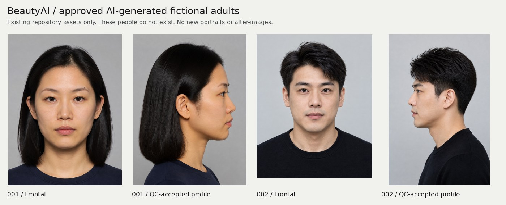

# BeautyAI tokens, components, and sample assets

Paths below are relative to the repository root. Source of truth: [`tokens.css`](https://github.com/tasconyeric-slack/BeautyAI/blob/dc140cb79dc8c80989ed44be379722118c82ef43/web/components/ds/tokens.css), [`globals.css`](https://github.com/tasconyeric-slack/BeautyAI/blob/dc140cb79dc8c80989ed44be379722118c82ef43/web/app/globals.css), [`layout.tsx`](https://github.com/tasconyeric-slack/BeautyAI/blob/dc140cb79dc8c80989ed44be379722118c82ef43/web/app/layout.tsx). Values describe current `main`, not proposed replacements.

## Token card

| Role | Current token / value |
|---|---|
| Reading / surface / muted surface | `--ap-reading #f1f1ee` · `--ap-surface #fafaf7` · `--ap-surface-muted #e9eae5` |
| Ink / soft / muted | `--ap-ink #16181a` · `--ap-ink-soft #454b4e` · `--ap-muted #646c6e` |
| Portrait stage | `--ap-stage #141618` · stage ink `#f1f1ee` |
| Primary / soft | `--ap-primary #1f4e5f` · `--ap-primary-soft #e0e8e9` |
| Caution / soft | `--ap-amber #9a5b1f` · `--ap-amber-soft #f1e8da` |
| Rules | `--ap-rule #d8d8d2` · strong `#b6bab5` |
| Dark equivalents | Reading `#191c1e`, surface `#222729`, ink `#f1f1ee`, primary `#9cc4ce` |
| Fonts | Display Noto Serif SC; app body Inter → Noto Sans SC; `.ap-ds` body Noto Sans SC; numeric token IBM Plex Mono → JetBrains Mono (IBM Plex is not loaded by layout). |
| Type sizes | XS 11 px, SM 13 px, base 15 px, LG 18 px; title `clamp(24px,3vw,32px)`; display `clamp(32px,4.5vw,60px)` |
| Space / shape | 4, 8, 12, 16, 24, 32, 48, 64 px; DS radii 3/8/pill; production cards also use 12–18 px. |
| Motion / theme | 150 ms; reveal 800 ms; `cubic-bezier(.2,.7,.3,1)`; system and explicit dark/light themes; reduced-motion overrides. |

`globals.css` aliases `--ap-*` to Tailwind `paper`, `ink`, `accent`, `stage`, etc. Update the shared system in a future implementation rather than creating an unrelated palette per page. Existing containers: homepage 1024 px; report 1152 px with 200 px contents column + 48 px gap + up to 768 px reading column; Studio portrait column up to 420 px. Header 48 px; desktop journey bar below it; mobile bottom navigation and safe areas must remain usable.

## Reuse and visual-change map

| Components / paths | Keep | Design treatment |
|---|---|---|
| `components/landing/{landing,client,cases}` | Existing six sections, tracking, CTA and topic/ref logic | Input to landing owner only: imagery, hierarchy, spacing, card treatment. |
| `components/report/{sample-report,full-report,report-model}` | Same renderer for live/sample; seven chapters, regions, scroll-spy/focus/deep links | Restyle cover, glance, disclosures, evidence rows and selected contents states. |
| `components/profile/{score-hero,score-glance}` | Computed values and limited/unavailable states | Reduce visual competition; never convert geometric reference into an attractiveness verdict. |
| `components/face/{atlas,workbench,measure-stage}` | Twelve-region atlas, crop/overlay coordinates, provenance, hover/focus preview and click-to-pin | Strong reusable foundation for QOVES-like evidence detail; no new analysis engine. |
| `components/ds/{Stage,CompareView,HoldButton}` | Neutral stage; pointer/touch/keyboard hold-original and cancel/blur restoration | Change surrounding chrome only; D31 prohibits replacing this with a drag slider. |
| `components/studio/{look-studio,*-controls,use-studio-canvas,compose,portrait-source}` | Layer order, source-specific geometry, local rendering, generation and expiry state machines | Top-level category navigation is a useful missing interaction; calm active/disabled controls and status panel. |
| `components/looks/{look-compare,look-pane,direction-picker}` | Existing A/B directions, saved selections, differences and decision | Improve discoverability from Studio; do not rebuild comparison. |
| `components/passport/{shell,journey,sheet}` | Desktop journey, mobile nav, dialog/sheet, Escape/focus handling | Restyle shared chrome; keep anchor offsets and portrait/control clearance. |
| `components/ui/{accordion,button,popover}` + DS swatches/feedback/confidence | Existing Radix-based disclosures, controls and feedback | Reuse for detail and reason panels; category tabs can use already-installed Radix. |
| `components/report/{export-pdf,pdf/**}`, share and plan components | PDF, save/copy/export, personal plan and deletion | Keep visible actions; PDF has its own renderer and bundled Noto Sans SC fonts. |

## Fictional portraits and reports

| Sample | Current report/data | Asset and result notes |
|---|---|---|
| AI fictional 001 | `/report/sample` or `?v=p001`; `ap_demo_p001`; `examples/demo_cases/person-001/` | Front 1088×1456, profile 1088×1456. Raw geometric score **83.3**; primary strength clear jawline; natural/classic styling. |
| AI fictional 002 | `/report/sample?v=p002`; `ap_demo_p002`; `examples/demo_cases/person-002/` | Front 1122×1402, profile 1024×1536. Raw score **81.9**; primary strength strong brows/deep eyes; natural/classic styling. |
| Older illustrated fixtures | `?v=female` / `?v=male`; `ap_sample_0001` / `ap_sample_0002` | `web/public/sample/*.svg`; illustrative hair variants and before/after art, not photoreal results. |

Approved JPEGs: `web/public/sample/demo/person-00{1,2}/{front,profile90}.jpg`. [Manifest](https://github.com/tasconyeric-slack/BeautyAI/blob/dc140cb79dc8c80989ed44be379722118c82ef43/examples/demo_cases/manifest.json) and each `provenance.json` establish approval/roles. Both new reports measured **113/117** items; four smile measurements are absent. Front and QC-accepted profile only are published; glasses reference is not published. Web snapshots live in `web/lib/fixtures/demo_cases/` and must remain byte-identical to `examples/`.

**Content binding:** homepage hero/score still uses the old illustrated fixture (87); its report preview uses 001 (displayed 83 after rounding). Coordinate this choice with the landing owner before replacing imagery. Public pipeline samples are unlocked/read-only and explicitly have **no generated previews**. Separate `docs/demos/issue-1-live-hair-previews.jpg` is pipeline demonstration evidence, not an after-image attached to these sample reports.

## Technical guardrails

Next.js **16.4.2 App Router**, React **19.3.1**, TypeScript strict, Tailwind **4.3.3**. Current dependencies already include Radix UI, Sonner, Lucide, CropperJS and react-compare-slider; Motion is absent. Read Next’s bundled guides before future code changes. Use server components where possible; isolate interactive controls in client components.

Preserve CV/model/rules provenance, schema contracts, server-trimmed entitlements, and D36/D37 score/cohort caveats. Never invent values for unmeasured regions. Keep failure/retry, locked, missing source, approximate mask, and 24-hour expired-media states. D40 source switching must not reuse another photo’s geometry; trying frames requires a glasses-free base. Private media intentionally uses plain images to avoid optimization/cache retention. SavedLooks stores options, not pixels. No user photos belong in this pack.

Policies: [CLAUDE.md](https://github.com/tasconyeric-slack/BeautyAI/blob/dc140cb79dc8c80989ed44be379722118c82ef43/CLAUDE.md), [V2.1](https://github.com/tasconyeric-slack/BeautyAI/blob/dc140cb79dc8c80989ed44be379722118c82ef43/docs/v2/V2_1_SPEC.md), [D31/D36/D37/D40/D41](https://github.com/tasconyeric-slack/BeautyAI/blob/dc140cb79dc8c80989ed44be379722118c82ef43/docs/DECISIONS.md). Preserve deferred commercialization ([#6](https://github.com/tasconyeric-slack/BeautyAI/issues/6)) and the learned-model integration gate ([#13](https://github.com/tasconyeric-slack/BeautyAI/issues/13)). Existing landing/journey work is [PR #8](https://github.com/tasconyeric-slack/BeautyAI/pull/8); this pack adds no parallel landing implementation.
