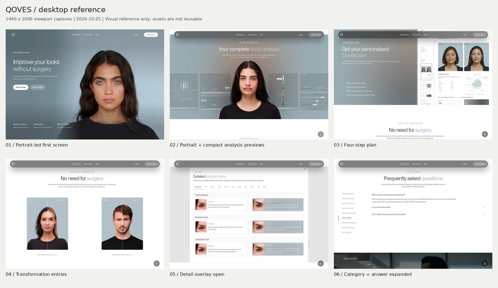
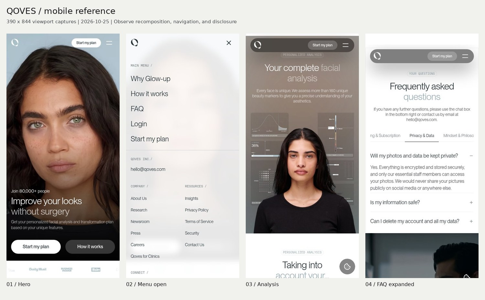
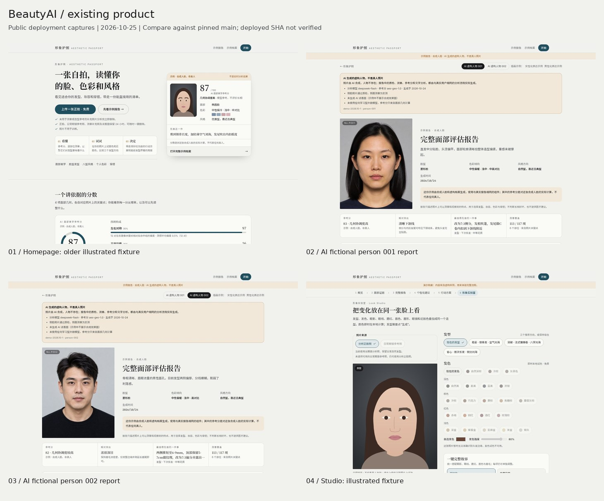

# BeautyAI · Claude Design input pack

**Direction: a calm, portrait-led styling consultation.** Borrow QOVES’s visual hierarchy and spatial rhythm; use BeautyAI’s own portraits, findings, vocabulary, and interactions. This is design input, not a page redesign or an implementation plan.

Inspected **2026-10-25**, against [`main@dc140cb`](https://github.com/tasconyeric-slack/BeautyAI/commit/dc140cb79dc8c80989ed44be379722118c82ef43). Start with the boards, then [reference observations](REFERENCE.md), [tokens and component inventory](INVENTORY.md), and [selective OSS sources](SOURCES.md).

## Visual brief

- **Composition:** give the portrait one clear focal area; place the conclusion and next action beside it. Alternate substantial image regions with quiet reading sections. Avoid turning every sentence into a card.
- **Palette:** retain warm paper, charcoal portrait stages, and the existing deep teal action color. QOVES’s desaturated blue-gray is a reference for restraint, not a replacement brand palette. Keep portrait pixels neutral so UI color does not change perceived skin or makeup.
- **Type:** retain the installed Inter / Noto Sans SC / Noto Serif SC families. Explore sans-led display copy with selective serif report titles. Proposal: desktop display 48–56 px, mobile 30–34 px, body 15–16 px with 1.7–1.8 line height. Judge Chinese wrapping directly; do not transfer tight Latin tracking to Chinese text.
- **Spacing and shape:** proposal: 64–96 px desktop section spacing, 40–56 px mobile; 16–24 px mobile gutters. Use thin rules, restrained panel radii, and pill primary actions. Keep dense evidence rows legible instead of enlarging every label.
- **Motion:** feedback at 150–200 ms; optional panel changes at 180–240 ms using opacity and small translations. These are proposed timings, not measured QOVES timings. Preserve reduced-motion behavior and immediate access to content.

## Page priorities

| Surface | First priority for Claude Design | Preserve |
|---|---|---|
| Homepage — coordinate with the existing landing owner | Align portrait choice, display type, gutters, and result-preview treatment. **Do not make a competing landing page or replacement section plan.** | Current `Hero → ScoreShowcase → ReportPreview → Cases → SeeIt → Privacy`; free-start and sample-report CTAs, topic/ref handling. |
| Report — primary design surface | Make portrait → conclusion → evidence → first action easy to scan; retain a prominent but more economical fictional-person/provenance block. Show selected, expanded, unavailable, expired, and export states. | Seven chapters, evidence deep links, sticky contents, sample selector, score caveats, PDF export. |
| Studio — primary interaction surface | Keep the portrait visible while making the many controls easier to browse. Explore a category navigator and clearer active choices, generation status, undo/reset/save, and compare entry. | Existing canvas/compositor, source switching, explicit generation, hold-original control, local SavedLooks and A/B comparison. |

## Boundaries for the next design pass

Use both approved fictional people, actual fixture values, and the existing Chinese copy. **Never combine a portrait with another sample’s score.** Keep the distinction between a local color simulation and an AI hair preview visible. Show a useful error/expired state alongside the ideal state.

No new measurement, score, demographic inference, medical recommendation, payment model, login, or progress-tracking feature is implied. No production UI, dependencies, or proprietary QOVES code/assets were added. QOVES screenshots are reference evidence only; do not extract or reuse their portraits, logos, fonts, or illustrations.

BeautyAI screenshots use the public deployment; its deployed SHA is not exposed/verified. Component and data conclusions come from the pinned repository. Studio capture uses the older illustrated fixture, not a successful real-photo edit.
